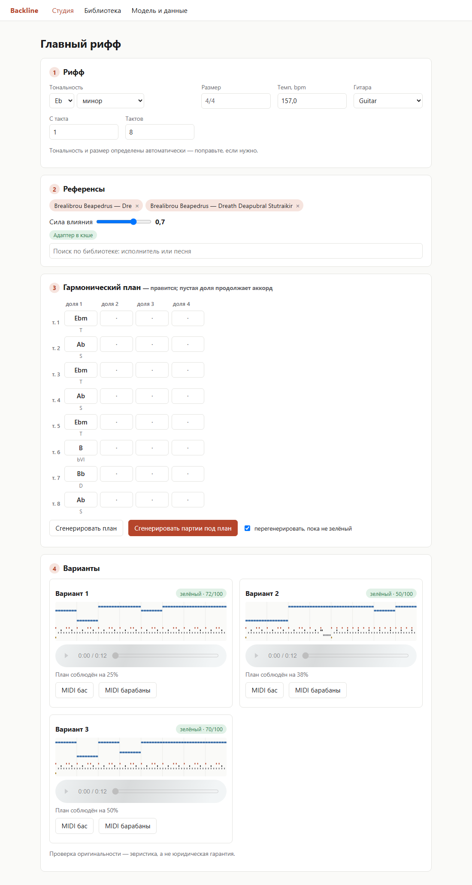
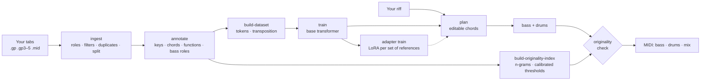
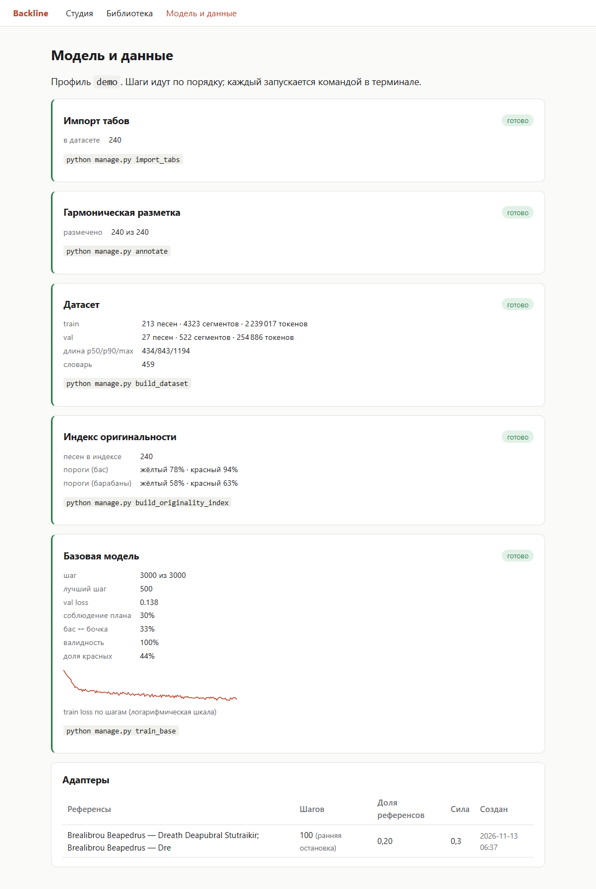

# Backline

**Bass and drums for your guitar riff, built on an explicit harmonic plan.**

You give Backline a riff (MIDI or Guitar Pro) and, if you like, a few reference songs
from your own tab library. The model first proposes a harmonic plan that you can edit,
then writes bass and drum parts under that plan. Every part is checked for copying
against the library it learned from.



> The repository holds only the system: code, configs, tests and docs. It publishes
> no tabs and no weights. You train it on your own library. The screenshots come from
> a small model trained on the synthetic songs that the test suite generates.

[Подробное описание на русском ниже ↓](#подробно-по-русски)

## What it does

- **Reads tabs and MIDI.** Guitar Pro 3–5 (`.gp3`, `.gp4`, `.gp5`), Guitar Pro 7/8
  (`.gp`) through its own GPIF reader, and MIDI (for example, exported from Ample
  Guitar). It keeps palm mutes, dead notes, ghost notes and accents.
- **Prepares a library.** For each file it finds the rhythm guitar, the bass and the
  drums. It drops files it can't use, merges other versions of the same song, and
  splits by song so that versions never leak between train and test.
- **Analyses harmony.** Keys (major, minor, Mixolydian, Dorian), a chord on every
  beat, harmonic functions, and the role of every bass note. It uses no third-party
  theory library.
- **Plans first.** A decoder-only transformer writes the harmonic plan first and the
  parts after it. You can edit the plan before the parts are written.
- **Leans towards references.** A LoRA adapter, trained on the songs you pick and
  cached, steers the parts towards them. A slider sets how strongly.
- **Checks originality.** An n-gram index of bass and drum patterns finds where a
  part copies a song in your library, even transposed or at double or half time.
- **Runs locally.** A CLI covers every step. A Django + HTMX studio sits on top of the
  same core package.

## How it works



Each song becomes one token sequence:

```
BOS META KEY TS TEMPO  GUITAR…  SEP  PLAN…  BASS…  DRUMS…  EOS
```

The guitar is the prompt. The model writes the plan, then the bass, then the drums.
Decoding is constrained by a grammar, so the output always has the right number of
bars, notes in range and tokens in order. Transposition augments the training set on
the fly.

## Quick start

Requires Python 3.12 and [uv](https://docs.astral.sh/uv/). A CUDA GPU helps with
training. The `tiny` profile runs end to end on a CPU.

```bash
uv sync --extra cuda --extra web      # or --extra cpu on a machine without a GPU
cp .env.example .env                  # where your tabs, data and weights live
uv run backline doctor                # checks PyTorch, CUDA and the paths
```

Try the whole pipeline on synthetic songs (CPU, a few minutes):

```bash
export BACKLINE_CONFIG=configs/tiny.yaml
uv run backline synth --n 40 --formats gp5 --out data/tabs
uv run backline ingest data/tabs
uv run backline annotate
uv run backline build-dataset
uv run backline build-originality-index
uv run backline train --device cpu
uv run backline generate your_riff.mid --out out/
```

Then start the studio. The second process runs the background jobs:

```bash
uv run python manage.py migrate
uv run python manage.py import_tabs   # the library for the UI (unchanged files are skipped)
uv run python manage.py runserver
uv run python manage.py run_huey      # in a second terminal
```

## Bring your own data

Put your tabs into `BACKLINE_TABS_DIR`, in any folder layout and with as many versions
as you have. `backline ingest` decides what is usable. It needs a guitar, a bass and
drums that play through most of the song, and it writes a report on everything it
skipped and why.

`backline triage` then sorts the files by what it takes to use them, with a hint for
each one: **ok**, **review** (in the dataset, but worth a look), **fixable** (a small
edit lets it in, e.g. a bass track named "Track 3" that the vote did not recognise, or
a `.gpx` to re-save as `.gp`), **rejected** (no bass or drums to learn from) and
**duplicate** (another version of a song already in). Fix what you can and run
`backline ingest` again: only changed files are re-read.

```bash
uv run backline triage                       # counts, then fixable / rejected / review files
uv run backline triage --csv triage.csv      # every file with its category and hints
uv run backline triage --move-rejected ../rejected --dry-run   # then without --dry-run
```

Rejected files are moved, never deleted, to a folder outside the library. The
Library page of the studio shows the same categories in Russian and exports a CSV for
Excel. As a rough guide:

| Usable songs | Profile | What to expect |
|---|---|---|
| < 300 | `small` | Enough to experiment; expect more copying, so keep the check on |
| 300–1,500 | `small` | A reasonable model, about 15M parameters |
| 1,500+ | `base` | The full model, about 60M parameters (RTX 5060 Ti: ~0.6 s/step, 5.5 GB) |

Get your tabs in line with the terms of the sites you take them from. Backline doesn't
download anything.

## The originality check, honestly

The check compares the bass (intervals and rhythm, plus scale degrees) and the drums
(kick, snare, hats, toms and cymbals per beat) with every song in **your** library. It
ignores transposition and catches double and half time. Patterns common to many songs
don't count against a part. A continuous copy of two bars or more is always red. Below
that, thresholds calibrated on your library decide the verdict. The report names the
song and the bars a part resembles.

It is a heuristic, not a legal opinion. It only knows your library, and it does not
look at melody, sound or lyrics. Treat green as "nothing found", not as "safe to
release".

## Development

```bash
uv sync --extra cpu --extra web
uv run pytest                    # synthetic data only, about 2–3 minutes
uv run ruff check . && uv run ruff format --check . && uv run mypy
```

CI runs the same commands on Ubuntu and Windows. The core (`src/backline`) is a pure
Python package. The Django project (`web/`) is a thin shell that only calls into it.

---

## Подробно (по-русски)

### Что это

Backline дописывает бас и барабаны к гитарному риффу. Вы загружаете рифф — MIDI
(например, из Ample Guitar) или Guitar Pro. При желании выбираете несколько
песен-референсов из своей библиотеки табов. Модель предлагает гармонический план:
аккорд на каждую долю. План можно поправить руками. Затем модель пишет партии баса и
барабанов строго под этот план. Каждая партия проверяется на заимствования из
библиотеки, на которой модель училась.

Система универсальная: в коде нет ни исполнителей, ни жанров. Её характер целиком
определяют ваши табы. Репозиторий содержит только саму систему. Данных и весов в нём
нет и не будет.

### Как это устроено

**1. Импорт (`backline ingest`).** Читает Guitar Pro 3–5 (через PyGuitarPro),
Guitar Pro 7/8 (собственный парсер GPIF) и MIDI. Сохраняет palm mute, dead notes, ghost
notes и акценты, учитывает triplet feel. Определяет роли дорожек голосованием по
инструменту, программе, названию и диапазону. Среди нескольких гитар выбирает
ритм-гитару. Отбрасывает файлы без баса, без барабанов или с партиями, которые звучат
меньше чем в 60% песни. Находит версии одной песни по нормализованному названию (с
транслитерацией кириллицы) и по транспозиционно-инвариантному отпечатку нот. Делит
библиотеку на train/val/test по песням, чтобы версии не разъезжались по разным
частям. Пишет каталог SQLite и JSON-отчёт о том, что и почему пропущено.

Барабаны сводятся к 15 классам (kick, snare, rim, три хай-хэта, три тома, две тарелки
crash, ride, ride bell, china, splash) и четырём уровням громкости (ghost, normal,
accent, max). Остальная перкуссия, grace notes и флэмы отбрасываются со счётчиком.
Если отброшено больше ~2% барабанных нот, отчёт предупреждает.

**2. Гармонический анализ (`backline annotate`).** Работает без music21. Аккорды по
долям находятся шаблонами и алгоритмом Витерби. Терция учитывается, только если она
звучит, поэтому квинтаккорд остаётся квинтаккордом. Корень подсказывают бас и нижняя
гитарная нота. Тональности определяются ладовыми профилями (мажор, минор,
миксолидийский, дорийский) с терпимостью к блюзовым ступеням и границами модуляций.
Функции: T, S, D, а также модальные ступени (bVII, bVI, bIII) с отдельной меткой. Для
каждой ноты баса определяется роль: аккордовая, проходящая, вспомогательная,
подход, блюзовая. На синтетических песнях с известной гармонией (`backline
eval-theory`) корень аккорда угадывается в ~98% долей, тоника в ~93%, роль ноты баса
в ~96%.

**3. Токенизация (`backline build-dataset`).** Сетка — 24 шага на четверть (дуоли,
триоли и шестнадцатые без округления). Словарь около 460 токенов. Последовательность:
мета, тональность, размер, темп, гитара, затем план, бас, барабаны. Песни режутся на
сегменты по 4–8 тактов, транспозиция добавляется на лету при обучении.

**4. Модель (`backline train`).** Декодер-трансформер: RMSNorm, RoPE, SwiGLU, KV-cache.
Есть три профиля: `tiny` для CI, `small` (~15M параметров) и `base` (~60M). Обучение в
bf16, с накоплением градиентов и точным возобновлением. Лучший чекпойнт выбирается по
val loss плюс штраф за долю «красных» генераций — модель, которая копирует, не
побеждает. Метрики пишутся в TensorBoard и в `metrics.jsonl`.

**5. Генерация (`backline generate`).** Декодирование ограничено грамматикой: число
тактов, диапазон баса и порядок токенов всегда корректны. Сначала план, потом партии
под него. Если план задан вручную, модель продолжает с него. Режим «перегенерировать,
пока не зелёный» повторяет варианты, которые проверка признала копией.

**6. Адаптеры под референсы (`backline adapter train`).** LoRA на проекциях внимания и
feed-forward. Доля референсов в батче выводится из числа проходов по ним, а не задаётся
константой. Обучение останавливается раньше, если модель начинает копировать
референсы. Адаптер кэшируется по ключу: отсортированные референсы + настройки адаптера +
хэш базового чекпойнта. Повторный выбор тех же песен срабатывает мгновенно. Сила
влияния регулируется ползунком, рекомендуемое значение подбирается автоматически.

**7. Проверка оригинальности.** Подробности — в следующем разделе.

### Проверка оригинальности: что она умеет и чего нет

Бас представляется двумя способами: интервалы с ритмом (отношения длительностей и
межнотных промежутков) и ступени лада. Барабаны — кодами долей: какие из пяти групп
(бочка, малый, хэты, томы, тарелки) звучат на каждой шестнадцатой. Поиск устроен
так: n-граммы → кандидаты → расширение совпадения с допуском на пару отличий. Паттерны,
которые встречаются во многих песнях, считаются общим языком и не засчитываются.
Транспозиция не влияет на результат, двойной и половинный темп ловятся.

Вердикт:
- **красный** — непрерывное совпадение с одной песней от 2 тактов или доля редких
  совпадений выше красного порога;
- **жёлтый** — выше жёлтого порога;
- **зелёный** — ничего значимого не найдено.

Пороги не заданы руками: они калибруются по вашей библиотеке как перцентили сходства
между разными песнями. В отчёте указаны песня и такты, на которые похожа партия.

Честно: это эвристика, а не юридическая гарантия. Проверка знает только вашу
библиотеку и не смотрит на мелодию, звук и текст. Зелёный значит «ничего не нашлось»,
а не «можно выпускать».

### Свои данные

1. Скопируйте `.env.example` в `.env` и укажите папки. `BACKLINE_TABS_DIR` — ваши табы,
   в любой структуре и с любым количеством версий.
2. `backline ingest` — импорт. Смотрите сводку и отчёт в `artifacts/reports/`:
   сколько песен попало в датасет, сколько отфильтровано и почему, какие дорожки
   определились неуверенно.
3. `backline triage` — сортировка табов по категориям, с подсказкой для каждого файла:
   - **годится** — попадает в датасет как есть;
   - **стоит проверить** — попадает, но роль дорожки определена неуверенно, выброшено
     много перкуссии или не указан исполнитель;
   - **можно поправить** — не попадает, но правка небольшая: дорожку баса назвали
     «Track 3» и её не распознали, бас или барабаны звучат чуть меньше порога, файл в
     старом формате `.gpx`;
   - **не подходит** — нет баса или барабанов, партии почти пустые: учиться не на чем;
   - **другие версии** — песня уже есть в датасете в другой версии.

   Поправьте файлы и запустите `backline ingest` ещё раз — перечитаются только
   изменённые. `--csv файл.csv` выгружает список целиком. `--move-rejected ПАПКА`
   переносит неподходящие файлы в папку вне библиотеки (сначала посмотрите с
   `--dry-run`). Ничего не удаляется. Те же категории — на странице «Библиотека» в
   студии, там же выгрузка CSV для Excel.
4. `backline annotate` → `backline build-dataset` → `backline build-originality-index`
   → `backline train`.

Сколько нужно табов. Минимум — 300–500 пригодных песен (профиль `small`), хорошо —
1,5–3 тысячи (профиль `base`). Скачивать можно всё подряд: импорт сам отсеет
непригодное. Пригодная песня — это гитара, бас и барабаны, которые играют большую
часть песни. Табы нужно брать в соответствии с правилами сайтов, откуда вы их берёте.
Backline ничего не скачивает сам.

Обучение на RTX 5060 Ti 16 GB: профиль `base` — около 0,6 с на шаг и 5,5 ГБ памяти.
Видеокартам Blackwell нужен PyTorch со сборкой CUDA 12.8 или новее. Его ставит
`uv sync --extra cuda`.

### Инструменты и экспорт

- **Бас.** Профили в `configs/base.yaml` (`instruments.bass.profiles`): 4 струны
  (стандарт, drop D, D standard) и 5 струн с нижней Си. Партия пишется в диапазоне
  выбранного профиля. Ample Bass P понижается до нижней Си пятиструнки.
- **Барабаны.** По умолчанию экспорт в General MIDI. Под конкретный кит задаётся своя
  карта: класс → нота (пример — `configs/drum_maps/sd3_signature_part2.yaml` для
  Superior Drummer 3). Если в ките нет какого-то класса, он помечается
  `substitute: true` и играется другим звуком. Студия предупреждает об этом на
  варианте: «china в ките нет — сыграно Crash 2».

### Студия

```bash
uv run python manage.py migrate
uv run python manage.py import_tabs
uv run python manage.py runserver     # http://127.0.0.1:8000
uv run python manage.py run_huey      # фоновые задачи, во втором терминале
```

Работа в студии идёт по шагам:

1. **Рифф.** Загрузите MIDI или Guitar Pro. Тональность, размер, темп, гитара и такты
   определятся сами, их можно поправить.
2. **Референсы.** Поиск по библиотеке, выбор песен, подготовка адаптера с прогрессом и
   ползунок силы влияния.
3. **План.** Таблица аккордов по долям с функциями под каждым аккордом. Пустая доля
   продолжает предыдущий аккорд, ошибки показываются с номером такта и доли.
4. **Варианты.** Пиано-ролл, где подсвечены такты, совпавшие с корпусом; вердикт и
   источники сходства; плеер в браузере; MIDI баса, барабанов и сведения.

Страница «Модель и данные» показывает, что уже собрано: импорт, разметку, датасет,
индекс с порогами, метрики и кривую обучения, адаптеры. Там же — команда для каждого
шага.



### Командная строка

| Команда | Что делает |
|---|---|
| `backline doctor` | Проверка окружения: Python, PyTorch/CUDA, пути, профиль |
| `backline synth` | Синтетические песни с известной гармонией |
| `backline inspect FILE` | Что Backline читает из файла: размеры, темпы, дорожки, ноты |
| `backline ingest [DIR]` | Импорт библиотеки табов |
| `backline catalog` | Сводка по импортированной библиотеке |
| `backline triage` | Сортировка табов: что поправить, что убрать; `--csv`, `--move-rejected` |
| `backline annotate` | Гармонический анализ |
| `backline eval-theory` | Точность анализа на синтетике |
| `backline build-dataset` | Токенизация в train/val/test |
| `backline build-originality-index` | Индекс для проверки оригинальности и калибровка порогов |
| `backline check-originality FILE` | Проверка баса и барабанов файла |
| `backline train` | Обучение базовой модели (возобновляется само) |
| `backline adapter train --ref ID…` | Адаптер под набор референсов (или из кэша) |
| `backline adapter list` | Кэшированные адаптеры |
| `backline generate RIFF` | План и партии под рифф; `--ref`, `--strength`, `--until-green` |

Настройки поведения — в YAML-профилях `configs/` (`base`, `small`, `tiny`; профиль
может наследовать другой через `extends:`). Пути — в переменных `BACKLINE_*` или в
`.env`.

### Разработка

Тесты и CI работают только на синтетических данных, реальные табы в тестах не
используются. Ядро (`src/backline`) — чистый Python-пакет без Django. Веб (`web/`) —
тонкая оболочка над ним. Стек: Python 3.12, uv, ruff, mypy (strict), pytest.

## License

Copyright © 2026 Ithinkimbulletproof. Licensed under the [GNU AGPL-3.0](LICENSE).
